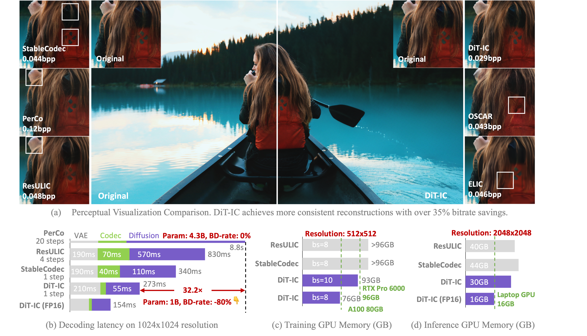

# DiT-IC — Aligned Diffusion Transformer for Efficient Image Compression

> Кратко: нейросетевой кодек для **экстремально низких битрейтов** (≈0.01–0.10 BPP),
> который использует diffusion transformer (DiT) для восстановления перцептивно
> качественного изображения из сильно сжатого латентного представления.

Оригинальный репозиторий: [njuvision/DiT-IC](https://github.com/njuvision/DiT-IC) ·
Статья: [arXiv:2603.13162](https://arxiv.org/abs/2603.13162) · CVPR 2026



---

## 1. Зачем нужен DiT-IC

Классические кодеки (JPEG, WebP, HEVC, VVC) оптимизированы под минимизацию
искажения (PSNR) и при очень низких битрейтах дают «мыльные» или блочные
изображения. DiT-IC ставит другую цель — **перцептивное качество**: изображение
должно выглядеть правдоподобно, даже если попиксельно отличается от оригинала.

Ключевая идея: сначала сжать изображение в компактный латент, а затем
**сгенерировать** качественную реконструкцию diffusion-моделью, используя
латент как условие. Это даёт выигрыш по LPIPS/DISTS и визуальному восприятию
при том же BPP.

---

## 2. Архитектура

Модель состоит из четырёх основных блоков.

| Блок | Что делает | Реализация |
| --- | --- | --- |
| **VAE (DC-AE)** | Кодирует RGB-изображение в латент 32×32 и декодирует обратно | `AutoencoderDC`, сжатие 32×, 32 латентных канала, `scaling_factor=0.41407` |
| **DiT (SANA)** | Один шаг диффузии: предсказывает очищенный латент | `SanaTransformer2DModel`, ~0.6B параметров, 28 слоёв, 36 голов, patch size 1 |
| **Latent codec** | Квантование, энтропийное моделирование и реальное кодирование латента | `LatentCodec`: analysis/synthesis transform, hyperprior, Gaussian conditional, checkerboard context, 5 slices |
| **Вспомогательный энкодер ELIC** | Даёт второе, «структурное» латентное представление, которое помогает кодеку | `ELIC.g_a`, латент 320 каналов |

### Путь данных

```
RGB ──► VAE encoder ──► латент 32×32
 │                            │
 └──► ELIC g_a ──► aux латент ─┴──► Latent codec (analysis transform)
                                        │
                                   quantize + hyperprior
                                        │
                                   rANS entropy coding ──► .bin (битстрим)
                                        │
                                   decompress ──► латент + prompt + scale
                                        │
                          LatentConditionAlignment (77 токенов × 2304)
                                        │
                                   SANA DiT (1 step, t = 999)
                                        │
                                   VAE decoder ──► RGB-реконструкция
```

### Компоненты подробнее

- **DC-AE VAE.** Латент в 32 раза меньше по каждой стороне, что делает диффузию
  в 32× латентном пространстве значительно дешевле, чем в пиксельном.
- **SANA DiT.** Работает как one-step denoiser: получает зашумлённый/сжатый латент
  и предсказывает его очищенную версию. В отличие от обычной генерации, здесь
  нет 20–50 шагов — используется один шаг с `t = 999`.
- **Latent codec.** Основан на гиперприоре (CompressAI): гиперэнкодер предсказывает
  параметры распределения, `GaussianConditional` кодирует основные латенты,
  checkerboard-контекст учитывает пространственные корреляции. Латент делится
  на 5 слайсов, что позволяет эффективно применять арифметическое кодирование.
- **Latent prompt + alignment.** Сжатый латент проецируется в 77 токенов
  размерности 2304 (48 адаптивных + 29 обучаемых pattern-токенов) и подаётся
  в cross-attention DiT как «текстовое» условие. Это заменяет текстовый энкодер.
- **LoRA.** В базовой модели дообучаются не все веса, а LoRA-адаптеры:
  rank 128 для DiT и rank 64 для VAE. В релизных merged-чекпоинтах LoRA уже
  влита в базовые веса, поэтому отдельные адаптеры при инференсе не нужны.
- **ELIC auxiliary encoder.** Дополнительный энкодер (из ELIC) формирует
  вспомогательный латент, который конкатенируется с латентом VAE. Веса этого
  энкодера входят в merged-чекпоинт.

### Обучение (кратко)

Двухстадийное:

1. **Stage 1 — без GAN.** Rate–distortion loss: MSE + LPIPS (AlexNet) + DISTS +
   скорость (KL/likelihood). Учит кодек и LoRA-адаптеры.
2. **Stage 2 — с GAN.** Добавляется hinge-дискриминатор (PatchGAN), что повышает
   перцептивное качество и резкость.

Параметр λ управляет trade-off «битрейт ↔ качество». В релизе четыре рабочие
точки: `q1…q4` (λ от 2⁴ до 2⁻²).

---

## 3. Точки качества и чекпоинты

| Точка | Файл | Примерный BPP (Kodak) | Назначение |
| --- | --- | --- | --- |
| q1 | `q1_merge_ema.pt` | 0.009 | экстремальное сжатие |
| q2 | `q2_merge_ema.pt` | 0.044 | очень низкий битрейт |
| **q3** | `q3_merge_ema.pt` | **0.081** | баланс (используется в этой работе) |
| q4 | `q4_merge_ema.pt` | 0.100 | максимальное качество из релиза |

Скачать: [HuggingFace — JunqiShi/DiT-IC](https://huggingface.co/JunqiShi/DiT-IC).
Каждый merged-чекпоинт — около **4.3 ГБ**.

---

## 4. Требования

- Python **3.12**
- PyTorch **2.8** с CUDA **12.8** (важно для RTX 50xx / sm_120)
- CompressAI **1.2.8** (от неё зависит расчёт BPP и энтропийное кодирование)
- GPU с ≥ 12–16 ГБ VRAM (в этой работе — RTX 5060 Ti 16 ГБ)
- ~5 ГБ на один чекпоинт + место под результаты

Остальные зависимости перечислены в `src/requirements.txt`.

---

## 5. Установка окружения

Самый простой способ — готовый скрипт (создаёт `.venv`, ставит Python 3.12,
PyTorch cu128, точные версии зависимостей и Jupyter-ядро `ditic`):

```powershell
powershell -ExecutionPolicy Bypass -File src\scripts\setup_env.ps1
```

Вручную:

```powershell
# Python 3.12 через uv (не затрагивает системный Python)
uv python install 3.12
uv venv --python 3.12 .venv

# PyTorch под CUDA 12.8 — обязательно первым шагом
uv pip install --python .venv\Scripts\python.exe `
    torch==2.8.0 torchvision==0.23.0 `
    --index-url https://download.pytorch.org/whl/cu128

# Точные версии остальных пакетов.
# --no-deps нужен из-за конфликтующих пинов upstream:
# compressai требует numpy<2, pyiqa 0.1.14.1 — transformers 4.37.2,
# а peft>=0.17 — более новый transformers.
uv pip install --python .venv\Scripts\python.exe --no-deps -r src\requirements-lock.txt

# Jupyter-ядро для ноутбука
.venv\Scripts\python.exe -m ipykernel install --prefix .venv --name ditic --display-name "DiT-IC (.venv)"
```

Проверка:

```powershell
.venv\Scripts\python.exe src\scripts\env_check.py
```

Скрипт печатает версии Python/PyTorch/CUDA, список GPU и сохраняет отчёт в
`src/result/logs/env_info.txt`.

---

## 6. Подготовка весов и данных

```powershell
# merged-чекпоинт q3 (~4.3 ГБ), с докачкой и параллельными соединениями
.venv\Scripts\python.exe src\scripts\fetch_weights.py `
  "https://huggingface.co/JunqiShi/DiT-IC/resolve/main/q3_merge_ema.pt" `
  "src\models\checkpoints\q3_merge_ema.pt"

# конфиги SANA уже лежат в src/models/sana
# тестовые изображения Kodak — в src/images/kodak
```

Ожидаемая структура:

```
src/
├── models/
│   ├── checkpoints/q3_merge_ema.pt
│   ├── configs/inference_q3.yaml
│   └── sana/{scheduler,transformer,vae}/
├── images/kodak/kodim01.png … kodim24.png
├── result/...
├── scripts/
└── experiments/DiT-IC.ipynb
```

---

## 7. Запуск инференса

### Вариант A: скрипт проекта (рекомендуется)

```powershell
# одно изображение — быстрая проверка
.venv\Scripts\python.exe src\scripts\run_dit_ic.py --limit 1

# весь Kodak: битстримы, реконструкции, метрики
.venv\Scripts\python.exe src\scripts\run_dit_ic.py
```

Результаты:

- `src/result/kodak/q3/bin/*.bin` — реальные битстримы;
- `src/result/kodak/q3/rec/*.png` — реконструкции;
- `src/result/metrics/dit_ic_q3.csv` — метрики по изображениям;
- `src/result/metrics/dit_ic_q3_summary.json` — средние значения, время, VRAM.

Скрипт **не изменяет** `DiT-IC/`: он только импортирует `models.DiT_IC.Codec`,
`eval.compress_utils` и `ELIC` и пишет всё в `src/result`.

### Вариант B: оригинальный `compress.py`

```powershell
cd DiT-IC
python -u compress.py `
  --config_path="configs/inference_merge.yaml" `
  --codec_path="../src/models/checkpoints/q3_merge_ema.pt" `
  --img_path="../src/images/kodak" `
  --rec_path="../src/result/kodak/q3/rec" `
  --bin_path="../src/result/kodak/q3/bin" `
  --use_merge --use_ema --save_img
```

> В оригинальном конфиге `dit_path: "SANA"` — путь относительно `DiT-IC/`.
> Для варианта A используется `src/models/configs/inference_q3.yaml` с путями
> внутри `src`.

---

## 8. Сравнение с JPEG и WebP

```powershell
# JPEG/WebP: сетка (масштаб × качество); BPP по фактическому размеру файла
.venv\Scripts\python.exe src\scripts\run_baselines.py

# RD-кривые, сравнение при одинаковом BPP
.venv\Scripts\python.exe src\scripts\make_plots.py
```

> При ~0.08 BPP JPEG/WebP не работают без уменьшения разрешения, поэтому
> baseline-скрипт кодирует уменьшенную версию изображения и после декодирования
> возвращает её к исходному размеру. Это стандартный способ получить для них
> сопоставимый битрейт; BPP считается по исходным пикселям.

Ноутбук `src/experiments/DiT-IC.ipynb` объединяет все шаги: проверку окружения,
запуск модели, метрики, графики и визуальное сравнение.

---

## 9. Результаты на Kodak

### 9.1 Условия эксперимента

- датасет: **Kodak**, 24 изображения 768×512 / 512×768;
- чекпоинт: `q3_merge_ema.pt` (merged EMA);
- реальное энтропийное кодирование (не оценка битрейта), BPP по размеру `.bin`;
- метрики: PSNR, MS-SSIM, LPIPS (AlexNet), DISTS, CLIP-IQA, MUSIQ;
- GPU: NVIDIA RTX 5060 Ti 16 ГБ, PyTorch 2.8.0+cu128.

### 9.2 Средние метрики DiT-IC q3

| Метрика | Значение |
| --- | --- |
| BPP | **0.0805** |
| PSNR | **24.25 dB** |
| MS-SSIM | **0.8708** |
| LPIPS | **0.0911** |
| DISTS | **0.0554** |
| CLIP-IQA | **0.7419** |
| MUSIQ | **74.39** |

Для сверки: в оригинальном README для q3 указаны BPP 0.08053, LPIPS 0.09113,
DISTS 0.05540 — результаты воспроизведены практически один в один.

### 9.3 Сравнение с JPEG и WebP при одинаковом BPP (0.0805)

Так как JPEG и WebP не достигают 0.08 BPP без уменьшения разрешения, для них
использовалась сетка «масштаб × качество»: изображение уменьшается перед
кодированием и возвращается к исходному размеру после декодирования. BPP
считается по исходному числу пикселей. Значения JPEG/WebP получены
интерполяцией их RD-кривых в точке 0.0805 BPP.

| Кодек | BPP | PSNR ↑ | MS-SSIM ↑ | LPIPS ↓ | DISTS ↓ | CLIP-IQA ↑ | MUSIQ ↑ |
| --- | --- | --- | --- | --- | --- | --- | --- |
| **DiT-IC q3** | 0.0805 | 24.25 | 0.871 | **0.091** | **0.055** | **0.742** | **74.4** |
| JPEG | 0.0805 | 23.96 | 0.866 | 0.623 | 0.299 | 0.405 | 29.1 |
| WebP | 0.0805 | **25.21** | **0.898** | 0.473 | 0.270 | 0.471 | 46.9 |

**Что это значит:**

- DiT-IC выигрывает у JPEG по **всем** метрикам, включая PSNR.
- WebP при таком битрейте сохраняет чуть более высокие PSNR/MS-SSIM за счёт
  размытия, но перцептивно проигрывает радикально: LPIPS 0.47 против 0.09,
  DISTS 0.27 против 0.055.
- Именно перцептивные метрики и визуальная правдоподобность — цель
  diffusion-based кодека; сравнение «в лоб» по PSNR для него не показательно.

### 9.4 Скорость и память

| Показатель | Значение |
| --- | --- |
| Параметров | 1.069 B |
| Загрузка модели | ~8–14 с |
| Encode (медиана) | **278 мс** |
| Decode (медиана) | **392 мс** |
| Пик VRAM | **6.1 ГБ** |
| Размер битстрима (средний) | ~3.96 КБ на изображение |

### 9.5 Где лежат результаты

- `src/result/metrics/dit_ic_q3.csv`, `dit_ic_q3_summary.json` — метрики DiT-IC;
- `src/result/metrics/baselines_kodak.csv` — все прогоны JPEG/WebP;
- `src/result/metrics/matched_bpp.csv` — сравнение при одинаковом BPP;
- `src/result/figures/rd_*.png` — RD-кривые;
- `src/result/figures/matched_bpp_bars.png` — столбчатое сравнение;
- `src/experiments/DiT-IC.ipynb` — выполненный ноутбук со всеми шагами и графиками.


---

## 10. Ограничения

- **Один чекпоинт q3.** В этой работе запущена только точка q3; q1/q2/q4
  можно добавить, заменив `codec_path` в конфиге.
- **Кратность 256.** Входное изображение дополняется до размера, кратного 256
  (reflect padding), затем обрезается. Для больших изображений это увеличивает
  вычисления.
- **Нет tiling / FP16.** В релизе заявлены как будущие улучшения; на 16 ГБ VRAM
  изображения сильно больше 1024×1024 могут не поместиться.
- **Стохастичность диффузии.** При `codec_mode: self_dist` используется
  детерминированное среднее; другие режимы добавляют шум и вариативность.
- **Скорость.** Один шаг DiT + VAE — это десятки/сотни миллисекунд на GPU
  против единиц миллисекунд у JPEG/WebP.
- **Метрики.** PSNR у генеративных кодеков может быть ниже, чем у классических
  при том же BPP; корректнее смотреть LPIPS/DISTS и визуальное качество.

---

## 11. Структура кода (ориентир)

| Файл | Роль |
| --- | --- |
| `DiT-IC/models/DiT_IC.py` | класс `Codec`: VAE + DiT + latent codec + prompter |
| `DiT-IC/models/latent_codec.py` | энтропийная модель и `compress`/`decompress` |
| `DiT-IC/models/scheduler.py` | one-step scheduler и адаптивный масштаб |
| `DiT-IC/models/losses.py` | rate–distortion + GAN + perceptual losses |
| `DiT-IC/ELIC/elic_official.py` | вспомогательный энкодер ELIC |
| `src/scripts/run_dit_ic.py` | инференс без изменения оригинального репозитория |
| `src/scripts/run_baselines.py` | JPEG/WebP baseline |
| `src/scripts/make_plots.py` | RD-кривые и сравнение при одном BPP |

---

## 12. Цитирование

```bibtex
@inproceedings{shi2026ditic,
  title={DiT-IC: Aligned Diffusion Transformer for Efficient Image Compression},
  author={Shi Junqi, Lu Ming, Li Xingchen, Ke Anle, Zhang Ruiqi and Ma Zhan},
  booktitle={CVPR},
  year={2026}
}
```
